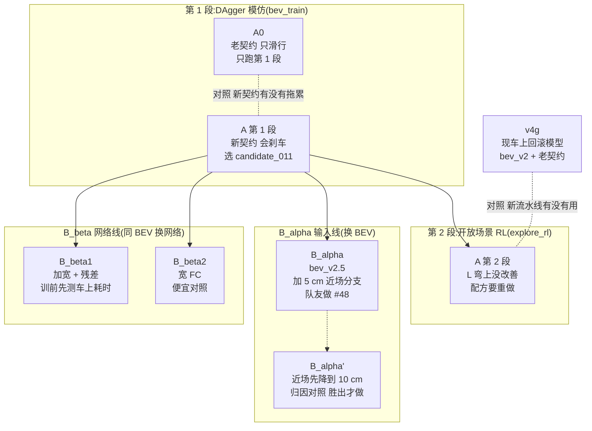

# v4.5 名字速查

忘了某个名字指什么就看这里。方案细节在 [v4.5方案.md](v4.5方案.md)。流程图用 Mermaid,Obsidian / GitHub 直接渲染。

## 流程

## 名字

| 名字 | 是什么 |
|---|---|
| **v4.5** | 这一轮从头重训的训练线(10-19 定) |
| **v4g** | v4 bev 训练的 g 组第 9 个 candidate;现在的回滚模型,用来比 |
| **r1A_064** | 车上开机模型 |
| **A** | v4.5 基线:网络和 v4g 一样,输入 bev_v2,新速度契约,从头训 |
| **A0** | A 的对照:只把速度契约换回老的(只滑行),只跑第 1 段 |
| **B_alpha** | 输入线:新 BEV bev_v2.5(多一张 5 cm 近场图),其余同 A |
| **B_alpha'** | B_alpha 的归因对照:近场图先合成 10 cm 再放大,看赢面是不是来自分辨率 |
| **B_beta1** | 网络线:卷积加宽 + 残差块,输入仍是 bev_v2 |
| **B_beta2** | 网络线:只把全连接加宽到 512,输入仍是 bev_v2 |

## 输入和契约

| 名字 | 是什么 |
|---|---|
| **bev_v2** | 现在的 BEV 输入:6 × 80 × 80(10 cm/格,车前 6 m、车后 2 m、左右各 4 m)+ 3 个标量 |
| **bev_v2.5** | bev_v2 + 64 × 64 的 5 cm 近场图(车前 2.6 m 到车后 0.6 m、左右各 1.6 m);和 bev_v2 并存 |
| **新契约** `_s5_v0.45-5_d0.2_log` | 速度输出分三段:前进(对数刻度 0.45–5 m/s)/ 中位滑行 / 刹车 |
| **老契约** `_s3_v0.45-3` | 只前进和滑行,没有刹车 |
| 6 个通道 | 雷达记忆、锥桶、胶带、区域标记、当拍雷达、可行驶地面;锥桶 / 胶带 / 区域标记现在恒为 0(没接 YOLO),保留不删 |

## 训练和评估

| 名字 | 是什么 |
|---|---|
| **第 1 段** | DAgger 模仿老师,`training/bev_train`,20 轮,每轮存一个 candidate |
| **第 2 段** | 开放场景 RL(PPO),`training/explore_rl`,从第 1 段挑出的 candidate 起步 |
| **candidate_NNN** | 第 NNN 轮存下的模型;全存,训完按 L 弯指标挑 |
| **L 弯测试** | `evaluation/l_test`;主指标 = 转向起始点(离前墙多远开始转),通过率当护栏 |
| **挑模型种子 / 测试种子** | 挑 candidate 用 SELECT 种子段,正式比较用 TEST 种子段,两段不重叠 |
| **老师** | SeenTeacher:只用学生能看到的地面,会刹车(新契约下) |

## 机器

| 名字 | 是什么 |
|---|---|
| **GCP 虚拟机** | 8 核 30 GB,稳定,慢;隧道的跳板 |
| **M6** | 租的 Mac(12 核),10-19 到期 |
| **M4** | 租的 Mac(10 核),隧道端口 2223;训练用 `--device mps` |

详细数字见 [训练机器.md](训练机器.md)。
