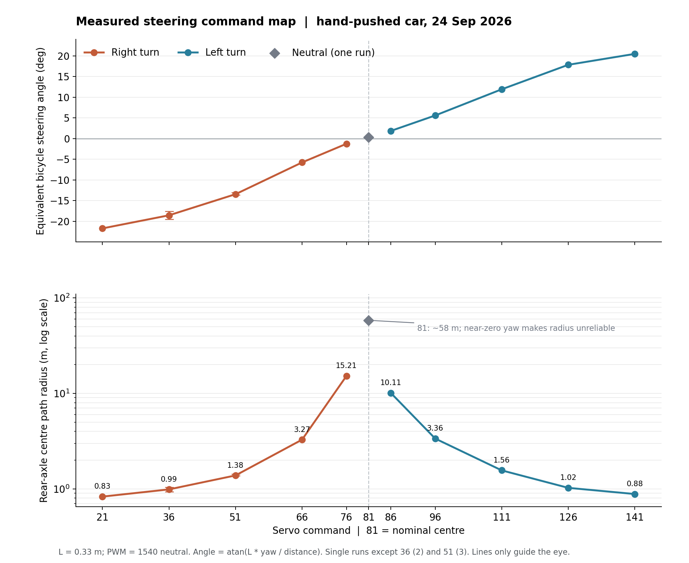

# 实车转向刻度、等效转角与转弯半径结论

测量日期：2026-09-24。轴距 **0.33 m**，左右轮中心距 **0.28 m**，舵机名义中位 **81**。右转为负角，左转为正角。以下是**低速手推、油门保持真中位 1540 PWM** 时测得的后轴中心轨迹；尚未用动力行驶复核。

## 结论

- 这 11 个刻度点构成一条连续、单调的初版转向映射。右转 21 到左转 141 的等效转角约为 **−21.7° 至 +20.5°**；两端后轴中心的实测半径约为 **0.83 m、0.88 m**。
- 舵机值与转角**并非整段线性关系**。靠近满舵时，增加 15 个刻度只带来约 2～3°；靠近中间时，同样的刻度变化更明显。建模和控制宜按下表插值，暂不宜只用一个最大转角参数代表整条曲线。
- 左右大致对称，但并不完全相同：51（右）半径约 **1.38 m**，111（左）约 **1.56 m**。这些差异可能来自转向机构、推行路径与传感器误差；当前数据不足以单独归因。
- 中位 81 只测过一次、约 3 m，运动段偏航很小。拟合的 **+0.3° / 58 m** 只是近直行的读数，**不能据此认定中位偏左 0.3°或把 58 m 当可靠半径**。计划再直推 4～5 m 复测。

## 可供模型使用的初版查表

半径是**后轴中心轨迹半径**，不是车辆最外侧扫过的包络半径。角度是由实际曲率和轴距算出的**等效自行车前轮角**，不是左、右前轮各自的机械转角。图中半径轴为对数刻度；点间连线仅帮助阅读，未测刻度暂按插值估计。

| 舵机值 | 方向 | 等效转角 | 实测后轴半径 | 有效趟数 |
| ---: | --- | ---: | ---: | ---: |
| 21 | 右 | −21.7° | 0.83 m | 1 |
| 36 | 右 | −18.6° | 0.99 m | 2 |
| 51 | 右 | −13.4° | 1.38 m | 3 |
| 66 | 右 | −5.8° | 3.27 m | 1 |
| 76 | 右 | −1.2° | 15.21 m | 1 |
| 81 | 名义中位 | +0.3° | 约 58 m，**不可靠** | 1 |
| 86 | 左 | +1.9° | 10.11 m | 1 |
| 96 | 左 | +5.6° | 3.36 m | 1 |
| 111 | 左 | +11.9° | 1.56 m | 1 |
| 126 | 左 | +17.9° | 1.02 m | 1 |
| 141 | 左 | +20.5° | 0.88 m | 1 |

## 测量与适用范围

`turn_push.py` 在每趟保持固定舵机值并只发送 1540 PWM。后轮编码器给出速度，IMU 给出偏航角速度；扣除静止陀螺零偏后，在稳定命令且手推速度 0.10～0.65 m/s 的样本上积分。**半径** `R = 路程 / |偏航弧度|`；**等效角** `δ = atan(0.33 × 偏航弧度 / 路程)`。36 和 51 用各趟结果的中位数，其余点各一趟。原始 CSV、计算脚本、绘图脚本和完整过程记录保留在测量电脑本地，不随此精简版推送；图上的误差棒只表示已测趟次的范围，并非统计置信区间。

手推数据适合建立**低速几何曲率**初版。动力行驶时轮胎侧滑、负载和转向回正可能改变轨迹；静态左右前轮角、舵机响应时间和速度依赖性本轮均未测。把这张图用于避障时，还须叠加车身宽度与前后悬的扫掠包络，不能把后轴半径直接当最小避障距离。

## 下一步

1. 复测中位 81 的较长直推，确认零点；如空间允许，再复测 76、86 的近中位曲率。
2. 在空旷地以动力低速短弧线验证几何映射，记录固定舵机值与速度，比较同刻度的半径。
3. 若要准确建模左右轮转角，分别测静态左右前轮角；若要建转向动态，还需测舵机从中位到目标值的响应时间。

本页及图片是仓库中的精简交付版本；需要复核每趟原始样本和现场中止原因时，请查测量电脑本地的完整记录。
